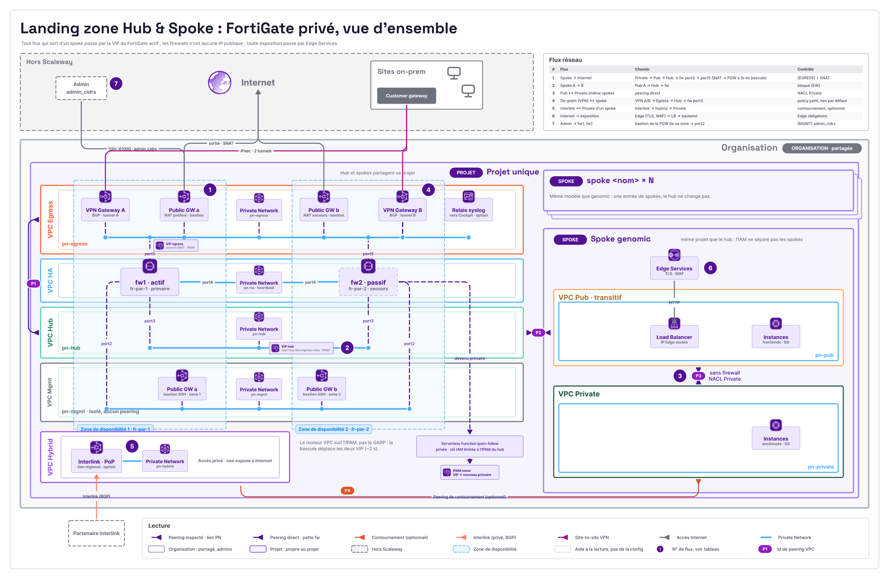

# Landing zone Scaleway hub & spoke avec FortiGate

Socle réseau d'une organisation Scaleway, en Terraform. Le hub est un projet qui porte deux firewalls FortiGate en haute disponibilité FGCP actif-passif, un par zone, ainsi que la sortie Internet, le VPN et Interlink. Chaque spoke a son projet, son groupe IAM, deux VPC (Pub et Private) et ses NACL. Ajouter un spoke ne touche pas aux firewalls.

Tout flux qui sort d'un spoke, ou qui y entre depuis l'extérieur, passe par le firewall, sauf le contournement Interlink (`hybrid_bypass`) et ce qu'un spoke expose lui-même (Load Balancer, IP publique) : voir les [limites](docs/OPERATIONS.md#limites-connues). La branche `hub-spoke-single-project` met le hub et les spokes dans un seul projet.



Les firewalls démarrent sur l'image d'usine de Fortinet et se configurent seuls au premier démarrage, avec les user data cloud-init de leur Instance. Un Serverless Container privé fait suivre au nouveau primaire les adresses virtuelles du hub.

## Contenu

```text
main.tf                    hub, spokes, expositions et relais de journaux
variables.tf, outputs.tf   entrées et sorties
terraform.tfvars.example   modèle de configuration
policy.yaml.example        modèle de politique firewall
backend.hcl.example        modèle de backend S3 pour le state
modules/hub                firewalls, VPC du hub, VPN, Interlink, bascule
modules/spoke              projet, VPC Pub et Private, NACL et IAM d'un spoke
modules/endpoint           Load Balancers et Edge Services
modules/observability      relais syslog vers Cockpit (optionnel)
```

## Prérequis

- Une organisation Scaleway et une clé API d'organisation (administrateur) : Terraform crée les projets, l'IAM et les clés de la bascule, et les connecteurs de peering du hub depuis chaque spoke.
- Deux licences FortiGate-VM BYOL de même niveau, une par nœud, enregistrées sur FortiCare (support.fortinet.com) qui fournit les fichiers `.lic`, à ne jamais versionner. FG-VM02 pour `POP2-2C-8G`, le type par défaut, FG-VM04 pour 4 vCPU. Aucun service FortiGuard payant n'est utilisé.
- L'image FortiOS pour KVM (`FGT_VM64_KVM-…kvm.zip` sur FortiCare, dont on extrait `fortios.qcow2`). Version validée : 8.0.2.
- Un bucket Object Storage privé et versionné en `fr-par` pour le state et le qcow2. Le state contient le mot de passe `admin`, les licences et les clés de bascule.
- L'IP publique fixe des administrateurs et de la machine qui déploie (`admin_cidrs`), et leurs clés SSH publiques (`admin_ssh_public_keys`).
- Pour une exposition, la main sur le DNS de son FQDN. Pour `vpn`, une passerelle on-prem IPsec avec BGP ; pour `interlink`, un lien commandé auprès d'un partenaire ou un lien dédié.

Sur la machine qui déploie : Terraform 1.10 ou plus, `scw`, `ssh` et `aws` (dépôt du qcow2).

```bash
export SCW_ACCESS_KEY=<clé> SCW_SECRET_KEY=<secret> SCW_DEFAULT_ORGANIZATION_ID=<id-organisation>
export AWS_ACCESS_KEY_ID=$SCW_ACCESS_KEY AWS_SECRET_ACCESS_KEY=$SCW_SECRET_KEY   # accès au bucket
scw object bucket create name=<bucket> region=fr-par enable-versioning=true      # privé par défaut
```

## Déploiement

1. Importer le qcow2 d'usine, un snapshot par zone (`fr-par-3` n'a ni Public Gateway ni Load Balancer) :

   ```bash
   aws s3 cp fortios.qcow2 s3://<bucket>/fortios.qcow2 --endpoint-url https://s3.fr-par.scw.cloud
   scw block snapshot import-from-object-storage zone=fr-par-1 bucket=<bucket> key=fortios.qcow2 name=fortios-<version>
   scw block snapshot import-from-object-storage zone=fr-par-2 bucket=<bucket> key=fortios.qcow2 name=fortios-<version>
   ```

   Ne démarrez jamais d'Instance sur ces snapshots à la main : un disque qui a déjà démarré ignore ses user data.

2. Copier `terraform.tfvars.example` en `terraform.tfvars` et `backend.hcl.example` en `backend.hcl`, puis les remplir : snapshots (`<zone>/<uuid>`), licences, `admin_cidrs`, spokes. Pour ouvrir des flux au firewall, copier `policy.yaml.example` en `policy.yaml`. Les options avancées du hub (adressage, taille des Public Gateways) sont des arguments de `module "hub"` dans `main.tf`.

3. Déployer. L'apply attend que les deux nœuds soient prêts (environ 3 min 30), puis pousse la politique :

   ```bash
   terraform init -backend-config=backend.hcl
   terraform plan -out=tfplan
   terraform apply tfplan
   ```

4. Récupérer les accès (SSH par le bastion, WebUI par tunnel `ssh -L`, accès direct si `admin_direct_access = true`) et le mot de passe `admin` :

   ```bash
   terraform output -json access
   terraform output -raw fw_admin_password
   ```

   Pour chaque exposition, créez un CNAME de son FQDN vers son `edge_cname_target` (sortie `endpoints`), sans quoi le certificat n'est pas émis.

## Tests

Hors ligne, sans appel à Scaleway :

```bash
terraform init -backend=false && terraform test
for m in hub spoke endpoint observability; do terraform -chdir=modules/$m init -backend=false && terraform -chdir=modules/$m test; done
bash modules/hub/test_fortigate.sh
python3 -m unittest discover -s modules/hub/ipam_follow
```

## Prouver la bascule

Depuis une VM d'un spoke, lancez un ping toutes les 100 ms vers une VM d'un autre spoke (est-ouest, à autoriser dans `policy.yaml`) et vers Internet (sortie par la VIP egress), puis faites tomber le primaire :

```bash
ping -D -i 0.1 <IP d'une VM d'un autre spoke> | tee ew.log
ping -D -i 0.1 1.1.1.1 | tee internet.log
```

- Bascule commandée, sur le primaire : `execute ha failover set 1`. Pour revenir, `execute ha failover unset 1` sur le même nœud ; tant que l'indicateur reste posé, ce nœud repasse secondaire à chaque retour du pair.
- Perte brutale : `set status down` d'un coup sur les ports hub, egress et HA du primaire. Arrêter ou redémarrer l'Instance ne simule pas une panne : FortiOS s'éteint proprement et passe la main.

Le temps de coupure est le plus grand écart entre deux `icmp_seq` consécutifs, multiplié par 0,1 s. `get system ha status` et le placement des VIP dans l'IPAM confirment le nouveau primaire.

Mesures du 3 novembre 2026 (FortiOS 8.0.2, deux spokes dans deux projets, ping toutes les 100 ms, une requête HTTPS vers Internet toutes les 200 ms) :

| Scénario | Est-ouest | Internet | HTTPS perdues |
|---|---|---|---|
| Bascule commandée fw1 vers fw2 | 0,1 s | 0,1 s | 0 |
| Bascule commandée fw2 vers fw1 | 2,1 s | 2,0 s | 2 |
| Reboot de l'Instance primaire | 1,0 s | 1,0 s | 1 |
| Perte brutale du primaire | 5,9 s | 5,9 s | 5 |
| Retour de l'ancien primaire | 0 s | 0 s | 0 |

Une perte brutale coûte la détection FGCP, 20 heartbeats manqués à 200 ms soit 4 s, puis 1 à 3 s avant la reprise : le Gratuitous ARP de FGCP déplace le next hop sans attendre l'IPAM. Le trafic reprend sans intervention.

Mesures du 4 novembre 2026 sur `hub-spoke-multi-project`, avec le VPN et un Load Balancer sur le réseau Egress :

| Scénario | Est-ouest | Internet | VPN | Requêtes LB perdues |
|---|---|---|---|---|
| Bascule commandée fw1 vers fw2 | 0 s | 0 s | 0 s | 0 |
| Retour fw2 vers fw1 | 2,2 s | 2,2 s | 2,2 s | 1 |

Le rôle de chaque mécanisme et les cas limites sont dans [docs/HA-CONTENEUR.md](docs/HA-CONTENEUR.md).

## Documentation

- [docs/ARCHITECTURE.md](docs/ARCHITECTURE.md) : flux, adressage, filtrage, administration, premier démarrage, bascule.
- [docs/OPERATIONS.md](docs/OPERATIONS.md) : spokes, politique, reconstruction d'un firewall, clés de bascule, accès direct, journaux, destruction, dépannage, limites.
