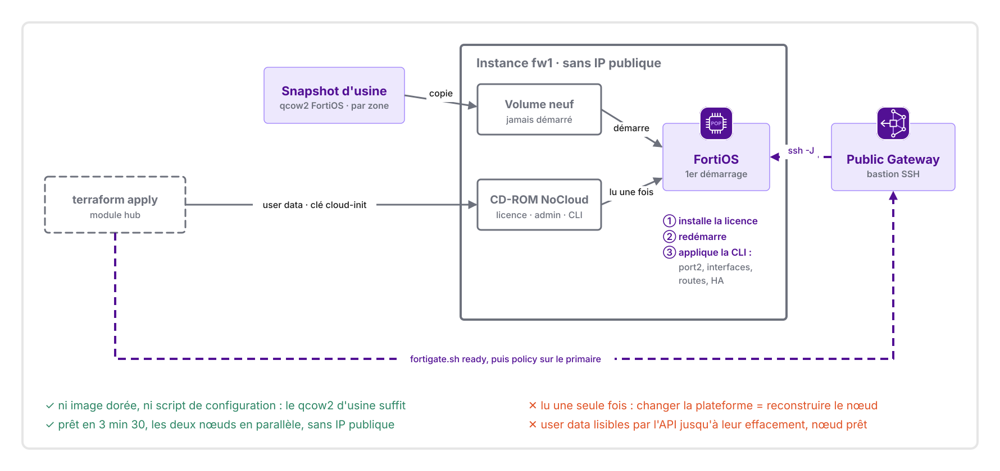
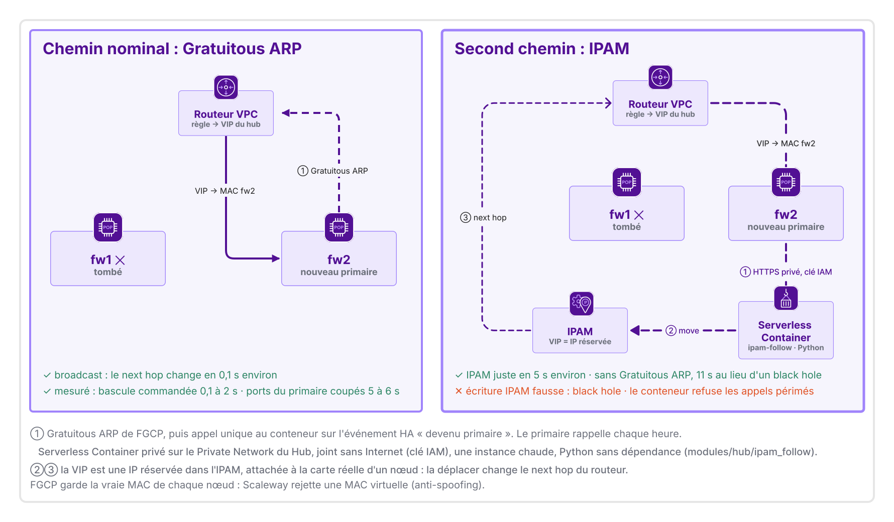

# Architecture

Pour déployer, voir le [README](../README.md).

## Flux

| Flux | Chemin | Contrôle |
|---|---|---|
| BU → Internet | Private → Pub → Hub → firewall → Public Gateway | firewall, NAT |
| BU A → BU B | → Hub → firewall | bloqué par défaut ; NACL de la BU cible |
| Pub ↔ Private (même BU) | peering direct | NACL |
| On-prem (VPN) ↔ BU | VPN → Egress → Hub → firewall | firewall et `nacl_inbound` |
| On-prem (Interlink) ↔ Private | Interlink → Hybrid → Private | sans firewall (`hybrid_bypass`) |
| Internet → BU | Load Balancer (Edge Services en option) créé dans la BU | hors firewall |

## Filtrage

## Haute disponibilité

Un seul firewall est actif (primaire FGCP). Les deux nœuds échangent un heartbeat unicast sur le réseau HA. Ils portent deux adresses virtuelles (VIP) de données, Hub et Egress, réservées dans l'IPAM.

## Administration

Les nœuds n'ont aucune IP publique. Leur port de management (`port2`) est sur le réseau `mgmt`, isolé, auquel est rattachée la Public Gateway de chaque zone (masquerade, route par défaut, bastion SSH). Un nœud se joint par le bastion de sa zone, depuis une adresse de `admin_cidrs` ; la passerelle de management HA de chaque nœud est la Public Gateway de sa zone.

## Premier démarrage

Terraform range dans les user data cloud-init de l'Instance la licence du nœud, le compte `admin` avec ses clés SSH et toute la plateforme (management, interfaces, routes, HA). Scaleway présente ces user data à une Instance sans IP publique sur un CD-ROM NoCloud. FortiOS (7.4.5+ ou 7.6.0+) le lit au premier démarrage, installe la licence, redémarre et applique la CLI. Il ne le relit jamais ensuite. On part donc toujours du qcow2 d'usine, et on reconstruit le nœud pour changer sa plateforme.

Un nœud est prêt en 3 min 30 environ, et les deux démarrent en parallèle. `fortigate.sh ready` vérifie alors le nœud par le bastion : clé `admin` acceptée, licence valide, ports dans le bon ordre. `fortigate.sh policy` pousse alors la politique sur le primaire, qui la synchronise. Terraform efface ensuite les user data de l'Instance, qui contiennent la licence et les mots de passe. Elles restent lisibles par l'API Instance pendant les quelques minutes du premier démarrage : réservez le projet DSI aux opérateurs.

## Bascule

Le routeur du VPC suit la réservation IPAM de la VIP du Hub, pas un ARP gratuit. Quand un nœud devient primaire, une automation FortiOS (événement journal 37892 `ha_role=primary`, répétée à 0, 10 et 30 s, plus un rattrapage toutes les heures) appelle une Serverless Function privée (`modules/dsi/failover.tf`, `modules/dsi/ipam_follow/handler.py`) qui déplace les deux VIP de données dans l'IPAM vers ce nœud. Le firewall ne détient qu'une clé IAM limitée à `FunctionsPrivateAccess` ; la clé de la fonction est limitée à `IPAMFullAccess` sur le projet DSI.

Mesures faites le 2 novembre 2026, avec deux VM de BU qui envoient 10 pings par seconde vers Internet à travers le firewall :

| Événement | Perte | Session HTTPS en cours |
|---|---|---|
| arrêt du primaire | 1 s | conservée |
| bascule forcée (`execute ha failover set 1`) | 0,2 s | conservée |
| retour de l'ancien primaire | aucune, pas de rebascule | conservée |

La fonction est une Scaleway Serverless Function privée (Python, sans dépendance, une instance toujours chaude) : elle n'est joignable qu'avec la clé IAM du firewall et n'a elle-même le droit que de modifier l'IPAM du projet DSI.

L'appel du firewall sort par la Public Gateway et joint le point d'accès public de la fonction, en HTTPS signé. Attacher la fonction à un Private Network n'y changerait rien : Scaleway n'y route que le trafic sortant de la fonction, pas l'appel entrant ([limites](https://www.scaleway.com/en/docs/serverless-functions/reference-content/functions-private-networks/)), et la fonction n'appelle que l'API publique `api.scaleway.com`. La bascule automatique dépend donc de la sortie Internet du Hub, comme le trafic Internet des BU : deux PGW dans deux zones, le rattrapage horaire et `failover_commands` couvrent ce risque. Quand Scaleway acceptera l'appel privé, il suffira d'attacher la fonction au Private Network de management et de changer l'URL appelée dans `fortigate-policy.conf.tftpl`.
