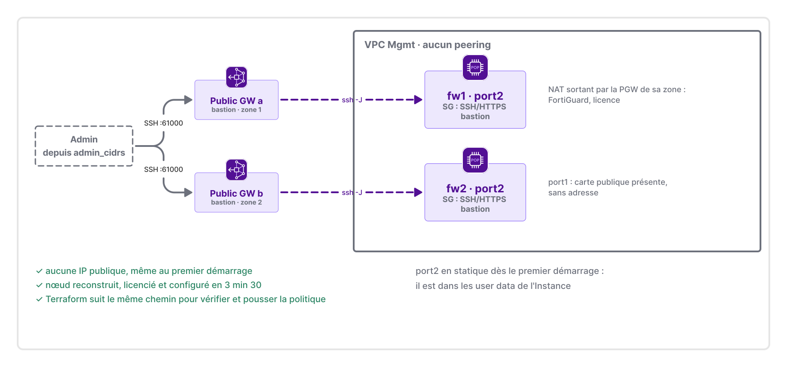

# Architecture

Pour déployer, voir le [README](../README.md).

## Flux

| Flux | Chemin | Contrôle |
|---|---|---|
| spoke → Internet | Private → Pub → Hub → firewall → Public Gateway | firewall, NAT |
| spoke A → spoke B | → Hub → firewall | bloqué par défaut ; NACL du spoke cible |
| Pub ↔ Private (même spoke) | peering direct | NACL |
| on-prem (VPN) ↔ spoke | VPN → Egress → Hub → firewall | règles de `policy.yaml` (aucune par défaut) et `nacl_inbound` |
| on-prem (Interlink) ↔ Private | Interlink → Hybrid → Private | sans firewall (`hybrid_bypass`) |
| Internet → exposition d'un spoke | Edge Services → Load Balancer du spoke | TLS et WAF, hors firewall |
| Internet → exposition du hub | Edge Services → Load Balancer du hub (Egress) → firewall → backend | TLS et WAF ; règle `[HUB]` de l'exposition |

## Adressage

Le hub occupe `10.0.4.0/24` (Egress), `10.0.5.0/24` (Hybrid), `10.0.6.0/24` (Mgmt), `172.16.0.0/24` (Hub) et `10.255.0.0/24` (heartbeat HA). Chaque spoke prend sa place dans `10.64.0.0/10` d'après son `index` : un `/22` Pub dans `10.64.0.0/12` et un `/21` Private dans `10.96.0.0/11` (index 1 : `10.64.4.0/22` et `10.96.8.0/21`). Si ces plages chevauchent l'on-prem, changez les arguments `cidrs` et `spoke_supernet` de `module "hub"` avant le premier apply.

## Filtrage

Le firewall refuse tout ce que sa politique n'ouvre pas. Par défaut, il bloque le trafic entre spokes et laisse sortir les spokes vers Internet. Le réseau Egress du hub n'atteint un spoke que sur les backends des expositions du hub, par une règle `[HUB]` limitée à leurs IP et à leur port. Les flux on-prem et les exceptions entre spokes se déclarent dans `policy.yaml`. Une exposition passe toujours par Edge Services, qui porte le certificat TLS et le WAF, et son Load Balancer n'accepte que les IP d'Edge Services.

## Administration

Les nœuds n'ont aucune IP publique. Leur port de management (`port2`) est sur le réseau `mgmt`, isolé, où la Public Gateway de chaque zone fait masquerade, route par défaut et bastion SSH. On joint un nœud par le bastion de sa zone, depuis une adresse de `admin_cidrs`.

Avec `admin_direct_access = true`, chaque Public Gateway redirige aussi ses ports 2222 et 8443 vers le SSH et le WebUI du nœud de sa zone. Ces redirections ne filtrent pas la source : c'est le security group de la carte de management qui n'admet que `admin_cidrs`.

## Premier démarrage

Terraform range dans les user data cloud-init de l'Instance la licence du nœud, le compte `admin` avec ses clés SSH et toute la plateforme : management, interfaces, routes, HA. Scaleway présente ces user data sur un CD-ROM NoCloud aux Instances sans IP publique. FortiOS (7.4.5+ ou 7.6.0+) le lit au premier démarrage, installe la licence, redémarre et applique la CLI. Il ne le relit jamais : on part toujours du qcow2 d'usine, et changer la plateforme d'un nœud veut dire le reconstruire.

Les deux nœuds démarrent en parallèle, en 3 min 30 environ. `fortigate.sh ready` vérifie alors chaque nœud par le bastion : clé `admin` acceptée, licence valide, ports dans le bon ordre. Il oublie d'abord les clés d'hôte qu'il avait retenues, car un nœud reconstruit ou une nouvelle Public Gateway en change. `fortigate.sh policy` pousse ensuite la politique sur le primaire, qui la synchronise. Terraform efface enfin les user data de l'Instance, qui contiennent la licence et les mots de passe : pendant ces quelques minutes, l'API Instance permet de les lire : réservez le projet du hub aux opérateurs.

## Haute disponibilité et bascule

Un seul firewall est actif, le primaire FGCP. Les deux nœuds échangent un heartbeat unicast sur le réseau HA et portent deux adresses virtuelles (VIP) de données, Hub et Egress, réservées dans l'IPAM. Le routeur du VPC suit la réservation IPAM de la VIP du Hub et ignore les ARP gratuits.

Quand un nœud devient primaire, une automation FortiOS (événement 37892 `ha_role=primary`, répétée à 0, 10 et 30 s, plus un rattrapage horaire) appelle un Serverless Container privé (`modules/hub/failover.tf`, `modules/hub/ipam_follow/handler.py`), qui déplace les deux VIP vers ce nœud dans l'IPAM. Le firewall ne détient qu'une clé IAM limitée à `ContainersPrivateAccess`, et celle du conteneur est limitée à `IPAMFullAccess` sur le projet du hub.

Le conteneur exécute le handler, sans dépendance, sur l'image Python officielle : pas de registre à alimenter. Il garde une instance chaude et n'a qu'un point d'accès privé, sur le Private Network du Hub, que chaque nœud joint par son port hub sans passer par Internet. FortiOS refuse de résoudre les noms en `.internal` et le certificat de ce point d'accès ne couvre que ce nom : le firewall l'appelle donc par son IP, lue dans l'IPAM par Terraform, en HTTPS sans vérification du nom. Ce réseau ne porte que les deux firewalls et le conteneur, et Scaleway rejette les trames à MAC source usurpée. Si un appel se perd, le rattrapage horaire ou la sortie `failover_commands` replace les VIP. FortiOS ne réserve pas ce rattrapage au primaire : le secondaire le lance aussi et demande les VIP pour lui. Mesuré le 3 novembre 2026, son appel reste sans effet : les VIP ne quittent pas le primaire et le trafic n'est pas coupé.

Les temps de coupure mesurés sont dans le README, section [Prouver la bascule](../README.md#prouver-la-bascule).
