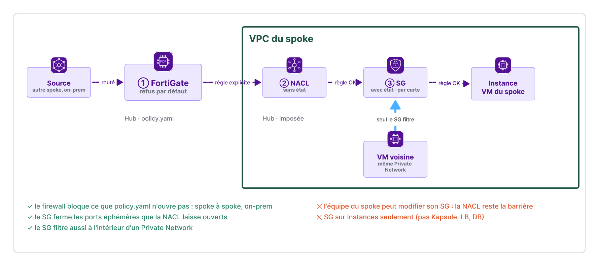

# Architecture

Pour déployer, voir le [README](../README.md).

## Flux

| Flux | Chemin | Contrôle |
|---|---|---|
| spoke → Internet | Private → Pub → Hub → firewall → Public Gateway | firewall, NAT |
| spoke A → spoke B | → Hub → firewall | bloqué par défaut ; NACL du spoke cible |
| Pub ↔ Private (même spoke) | peering direct | NACL |
| on-prem (VPN) ↔ spoke | VPN → Egress → Hub → firewall | règles de `policy.yaml` (aucune par défaut) et `nacl_inbound` |
| on-prem (Interlink) ↔ Private | Interlink → Hybrid → Private | sans firewall (`hybrid_bypass`) |
| Internet → exposition d'un spoke | Edge Services → Load Balancer du spoke | TLS et WAF, hors firewall |
| Internet → exposition du hub | Edge Services → Load Balancer du hub (Egress) → firewall → backend | TLS et WAF ; règle `[HUB]` de l'exposition |

## Adressage

Le hub occupe `10.0.4.0/24` (Egress), `10.0.5.0/24` (Hybrid), `10.0.6.0/24` (Mgmt), `172.16.0.0/24` (Hub) et `10.255.0.0/24` (heartbeat HA). Chaque spoke prend sa place dans `10.64.0.0/10` d'après son `index` : un `/22` Pub dans `10.64.0.0/12` et un `/21` Private dans `10.96.0.0/11`. Le spoke d'index 1 a ainsi `10.64.4.0/22` et `10.96.8.0/21`. Si ces plages chevauchent l'on-prem, changez les arguments `cidrs` et `spoke_supernet` de `module "hub"` avant le premier apply.

## Filtrage

La politique du firewall refuse tout ce qu'elle n'ouvre pas. Par défaut, elle bloque le trafic entre spokes et laisse sortir les spokes vers Internet. Le réseau Egress du hub n'atteint un spoke que sur les backends des expositions du hub : une règle `[HUB]` par exposition, limitée aux IP et au port de ses backends. Les flux on-prem et les exceptions entre spokes se déclarent dans `policy.yaml`. Une exposition passe toujours par Edge Services, qui porte le certificat TLS et le WAF, et son Load Balancer n'accepte que les IP d'Edge Services.

## Haute disponibilité

Un seul firewall est actif, le primaire FGCP. Les deux nœuds échangent un heartbeat unicast sur le réseau HA et portent deux adresses virtuelles (VIP) de données, Hub et Egress, réservées dans l'IPAM.

## Administration

Les nœuds n'ont aucune IP publique. Leur port de management (`port2`) est sur le réseau `mgmt`, isolé, où est rattachée la Public Gateway de chaque zone (masquerade, route par défaut, bastion SSH). On joint un nœud par le bastion de sa zone, depuis une adresse de `admin_cidrs`.

## Premier démarrage

Terraform range dans les user data cloud-init de l'Instance la licence du nœud, le compte `admin` avec ses clés SSH et toute la plateforme (management, interfaces, routes, HA). Scaleway présente ces user data sur un CD-ROM NoCloud aux Instances sans IP publique. FortiOS (7.4.5+ ou 7.6.0+) le lit au premier démarrage, installe la licence, redémarre et applique la CLI. Il ne le relit jamais : on part toujours du qcow2 d'usine, et changer la plateforme d'un nœud veut dire le reconstruire.

Un nœud est prêt en 3 min 30 environ, et les deux démarrent en parallèle. `fortigate.sh ready` vérifie alors chaque nœud par le bastion (clé `admin` acceptée, licence valide, ports dans le bon ordre), puis `fortigate.sh policy` pousse la politique sur le primaire, qui la synchronise. Terraform efface enfin les user data de l'Instance, qui contiennent la licence et les mots de passe. Pendant les quelques minutes du premier démarrage, l'API Instance permet de les lire, à tout opérateur du projet.

## Bascule

Le routeur du VPC suit la réservation IPAM de la VIP du Hub et ignore les ARP gratuits. Quand un nœud devient primaire, une automation FortiOS (événement 37892 `ha_role=primary`, répétée à 0, 10 et 30 s, plus un rattrapage toutes les heures) appelle un Serverless Container privé (`modules/hub/failover.tf`, `modules/hub/ipam_follow/handler.py`). Le conteneur déplace les deux VIP de données vers ce nœud dans l'IPAM. Le firewall ne détient qu'une clé IAM limitée à `ContainersPrivateAccess`, et la clé du conteneur est limitée à `IPAMFullAccess` sur le projet.

Mesures du 2 novembre 2026, avec deux VM de spoke qui envoient 10 pings par seconde vers Internet à travers le firewall :

| Événement | Perte | Session HTTPS en cours |
|---|---|---|
| arrêt du primaire | 1 s | conservée |
| bascule forcée (`execute ha failover set 1`) | 0,2 s | conservée |
| retour de l'ancien primaire | aucune, pas de rebascule | conservée |

Le 3 novembre 2026, après le passage au conteneur, deux bascules forcées par `diagnose sys ha reset-uptime`, de fw1 vers fw2 puis retour, ont coûté 0,2 s puis 1 s de perte (5 pings par seconde), et les deux VIP ont suivi le nouveau primaire dans l'IPAM.

Le conteneur tourne sur l'image Python officielle, avec le handler sans dépendance passé en commande : il n'y a pas de registre à alimenter. Il garde une instance chaude et n'a pas de point d'accès public. Son point d'accès privé est dans le Private Network du Hub, que chaque nœud joint directement par son port hub : l'appel ne passe ni par Internet ni par les Public Gateways. Le firewall l'appelle par son adresse IP, que Terraform lit dans l'IPAM et injecte au push de la politique, en HTTPS sans vérification du nom. FortiOS refuse en effet de résoudre les noms en `.internal`, et le certificat du point d'accès privé ne couvre que ce nom. Le Private Network du Hub ne porte que les deux firewalls et le conteneur, et Scaleway rejette les trames dont l'adresse MAC source n'est pas celle de la VM. Le rattrapage horaire et la sortie `failover_commands` couvrent un appel perdu.
