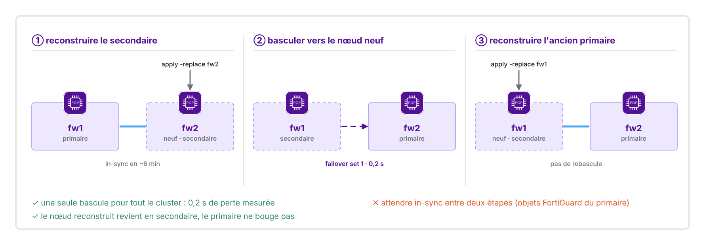

# Exploitation

Après chaque modification : `terragrunt plan`, relecture, puis `terragrunt apply`.

## Ajouter une BU

Ajoutez une entrée dans `live/bus.yaml` avec un `index` unique (0-1023), puis créez son unité et appliquez. Le firewall n'est jamais modifié. Ne changez jamais l'`index` d'une BU existante.

```bash
mkdir live/bus/<bu> && cp live/bus/genomic/terragrunt.hcl live/bus/<bu>/
terragrunt apply --working-dir live/bus/<bu>
```

Dans la même entrée de `bus.yaml` : `nacl_inbound` ouvre un flux entrant, `hybrid_bypass: true` relie la BU à Interlink (demande `interlink` dans la DSI), `edge_services_plan` active Edge Services. Après modification, `apply` de l'unité BU. Les membres du groupe IAM de la BU sont gérés hors Terraform.

## Retirer une BU

La BU vide d'abord son projet (instances, LB, volumes, bases, buckets). Puis :

```bash
terragrunt run --all --working-dir live/bus/<bu> -- destroy
```

Supprimez ensuite le dossier et l'entrée de `bus.yaml`. Gardez l'`index` réservé tant que le projet n'est pas détruit.

## Changer la politique du firewall

Modifiez `live/dsi/policy.yaml` (format : [CONFIGURATION.md](CONFIGURATION.md)), puis `terragrunt apply --working-dir live/dsi`. Les règles sont poussées en direct sur le primaire FGCP, qui synchronise le secondaire, sans redémarrage. Un réglage fait dans le WebUI est écrasé au prochain push.

## Reconstruire un firewall

FortiOS ne lit ses user data qu'une fois. Un changement de plateforme (interfaces, HA, passerelles, syslog, licence, clés `admin`) ou de version passe donc par une reconstruction ; le plan l'annonce par une mise à jour de `terraform_data.fw_config`, qui garde la plateforme en clair et les user data sous forme de hash. Un nœud par `apply`, le secondaire d'abord :

```bash
ssh -J <bastion> admin@<ip-mgmt> 'get system ha status'                                  # qui est primaire ?
terragrunt apply --working-dir live/dsi -replace='terraform_data.fw_generation["fw2"]'   # le secondaire
# sur le primaire, en SSH : execute ha failover set 1   (confirmer par y)
terragrunt apply --working-dir live/dsi -replace='terraform_data.fw_generation["fw1"]'   # l'ancien primaire
```



Un nœud reconstruit revient en secondaire et le cluster ne rebascule pas. Il peut rester *out-of-sync* 5 à 6 minutes, le temps que le primaire mette à jour ses objets FortiGuard : attendez `in-sync` avant l'étape suivante. Pour changer de version, remplacez le `snapshot_id` d'un nœud, puis de l'autre, dans le même ordre.

## Faire tourner les clés de bascule

Deux clés API : celle du firewall (`FunctionsPrivateAccess`) et celle de la fonction (`IPAMFullAccess`).

```bash
terragrunt apply --working-dir live/dsi -replace='scaleway_iam_api_key.fw_invoke'    # clé du firewall
terragrunt apply --working-dir live/dsi -replace='scaleway_iam_api_key.ipam_follow'  # clé de la fonction
```

La première est repoussée aux firewalls avec la politique, la seconde est redéployée dans la fonction : aucune reconstruction. Si une bascule échoue entre-temps, déplacez les VIP à la main avec la ligne du primaire :

```bash
terragrunt output -json failover_commands --working-dir live/dsi
```

## Détruire

Les ressources des BU (instances, LB, volumes, bases, buckets) doivent être supprimées avant.

```bash
cd live && terragrunt run --all -- destroy
```

Si l'erreur `resource is still in use` apparaît, supprimez les security groups « Default » créés par Scaleway dans le projet de la BU, puis relancez :

```bash
scw instance security-group list zone=fr-par-1 project-id=<id-projet-BU>
scw instance security-group delete <id> zone=fr-par-1
```

Faites de même dans `fr-par-2` si des VM y ont tourné. Notez les `project_id` (`terragrunt output project_id --working-dir live/bus/<bu>`) avant la destruction.

## Dépannage

| Symptôme | Cause | Action |
|---|---|---|
| `stdio forwarding failed` en SSH vers un firewall | il démarre encore | attendre quelques minutes |
| `Connection timed out during banner exchange` vers une VM | port fermé par la NACL de la BU | ajouter une règle `nacl_inbound` dans `bus.yaml`, puis `apply` de la BU |
| Plus de trafic via le hub ou vers Internet après une bascule | VIP restées sur l'ancien primaire (fonction de bascule en échec) | `failover_commands`, lancer la ligne du primaire FGCP |
| `fortigate.sh ready` ou le push de politique échoue en SSH | le poste n'est pas dans `admin_cidrs`, ou `ssh`, `scw` manquent | corriger, puis relancer l'apply |
| `admin key never accepted: user data not applied` | FortiOS n'a pas lu ses user data : le disque avait déjà démarré, ou l'Instance a une IP publique (pas de CD-ROM NoCloud) | partir du snapshot d'usine, sans IP publique, et reconstruire ; en console série, `diagnose debug cloudinit show` montre ce que FortiOS a lu |
| Le plan échoue sur `yamldecode` ou refuse la politique | erreur de syntaxe, alias inconnu, description en double ou contenant `<`, `>`, `&` | corriger `policy.yaml` |
| Le plan refuse les CIDR | chevauchement entre `cidrs`, `bu_supernet` et les CIDR on-prem | corriger les valeurs |
| Le certificat Edge Services n'est pas émis | le CNAME du FQDN manque | créer le CNAME vers `edge_cname_target` |
| `terragrunt` ne voit pas une modification de module | cache local | ajouter `--source-update` |
| `resource is still in use` à la destruction d'une BU | security group « Default » dans le projet | voir « Détruire » |

## Limites connues

- Redis, MongoDB, Kafka, OpenSearch et ClickHouse ne suivent pas le routage VPC : ils ne sont joignables que depuis leur Private Network.
- Exposition directe : les chemins Internet qu'une BU crée elle-même ne passent pas par le firewall : IP publique d'instance (`InstancesFullAccess`), Load Balancer, nœuds Kapsule avec IP publique. Le contrôle passe par IAM et par un inventaire des projets BU (`scw instance ip list project-id=<projet>`, `scw lb list project-id=<projet>`). Retirer `InstancesFullAccess`, `LoadBalancersFullAccess` ou `KubernetesFullAccess` de `iam_permission_sets` ferme ces voies.
- Le state DSI contient le mot de passe `admin`, le mot de passe HA, les user data des firewalls (licence comprise) et les clés API de bascule : protégez le bucket.
- Le firewall ne détient qu'une clé `FunctionsPrivateAccess`, qui permet seulement d'appeler la fonction privée ; la clé `IPAMFullAccess` reste dans la fonction, limitée au projet DSI.
- Par défaut, les règles sont en *sloppy state* : le firewall ne vérifie plus les numéros de séquence TCP, et les sessions survivent à une bascule de firewall. Elles ne survivent jamais à la perte d'une Public Gateway, car l'IP publique change.
- `policy.nat_outbound` n'est pas pris en charge : le trafic Internet des BU est traduit vers la VIP egress par la règle `[EGRESS]`.
- Les licences sont en BYOL, une par nœud.
- Dans les NACL, les retours sont ouverts en TCP et UDP sur 32768-65535 depuis toute source : un service qui écoute sur ces ports est joignable de l'extérieur de la BU (le firewall filtre ce qui vient du Hub, pas le bypass Interlink), sauf sur une instance qui porte le security group de référence de la BU. Pas de NACL ni de routes IPv6.
- Le filtrage a trois niveaux : le firewall entre VPC, les NACL de la DSI aux frontières des VPC BU, les security groups au niveau de chaque carte Private Network (`security_group_ids` de l'unité BU, à poser par la BU sur ses instances). La BU peut les modifier ou les détacher : le contrôle passe par Audit Trail et un inventaire des cartes sans groupe. Côté DSI, la carte de management des firewalls n'accepte que SSH et HTTPS depuis les bastions des PGW ; les cartes hub, egress et heartbeat n'ont pas de groupe (le firewall filtre). Un security group sur une carte Private Network y désactive l'IPv6.
- Le trafic d'Edge Services vers les Load Balancers est en HTTP, non chiffré.
- Scaleway n'expose aucun timer BGP, BFD ou DPD : la vitesse de bascule entre les deux tunnels VPN se règle sur la passerelle on-prem.
- Quand une BU est ajoutée, les VM déjà démarrées reçoivent ses routes par DHCP en une heure au plus.
- Le quota de peering est de 512 connecteurs par organisation : 127 BU sans bypass, 85 avec.
- Les journaux restent locaux sauf si vous renseignez `firewall.syslog` ou déployez le relais d'observabilité.
